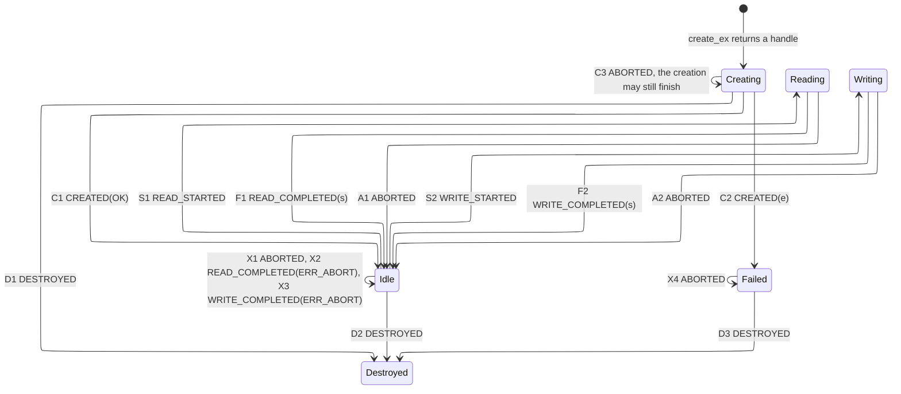

# libplctag core model

This document describes a simplified model of libplctag core, that the .NET wrapper relies on and is tested against.

**API calls request transitions. Callbacks report them.** Nothing outside the core can see a tag's actual state. All a
caller ever learns is a sequence of callbacks, each an event with a status code. The model is therefore a state machine
whose inputs are those events and their statuses: its state is what the callbacks so far say about the tag, not what
the core holds right now.

## Assumptions

What the state machine below does not already say:

1. **Every event is delivered, once, in the order the core made the transitions.** Events are not merged, dropped or
   reordered. So the state the model has reached is always one the tag has actually been in, but it may lag: the core
   can be ahead of it by events not yet delivered.
2. **Callbacks for one tag are serialised** under the tag's `api_mutex` and run to completion in order. Callbacks for
   different tags may run concurrently. This is implied by the 2.7.3 callback rules and issue #667, but it is not a
   stated contract.
3. **Callbacks run on any thread.** Caller-initiated events (`READ_STARTED`, `WRITE_STARTED`, `ABORTED`, `DESTROYED`)
   fire on the caller's thread before the call returns, so their order matches call order. Completion events
   (`CREATED`, `READ_COMPLETED`, `WRITE_COMPLETED`) fire on the tickler thread, and there is no telling in advance
   where they fall among caller events; by assumption 1 they still arrive in the order the transitions happened.
4. **Every `STARTED` is eventually followed by a `COMPLETED` or an `ABORTED`.** A read that is refused or served from
   the cache raises no `READ_STARTED`.

The model covers correct behaviour only; see Core bugs below.

### What the wrapper relies on

Of all the above, the wrapper's async methods need only one:

> **If `read()` (or `write()`) accepts the request, at least one `COMPLETED` or `ABORTED` is delivered after the call
> began.**

The wrapper creates its `TaskCompletionSource` *before* calling `read()`, so that event completes it, even if the core
raises it before `read()` returns. The first ending event wins; any later one finds the task complete and is absorbed.
The wrapper does not assume its call caused the event, that events arrive in order, or which thread they come on.

So a completed task means only "a read ended after I started waiting":

- Its status may be another operation's: a late event from an earlier read can win. With correct core behaviour that
  should not happen, but it is not ruled out.
- The data may predate the call, for the same reason.
- A read already in flight (`ERR_BUSY`) is handled the same way: wait for the next ending event.

### Terms

- **Event**: one callback, `(event, status)`. The model's only input.
- **Request**: what an API call asks the core to do. It is reported, if at all, by the events that follow.
- **Absorbed**: an event that arrives in a state where it changes nothing, drawn as a self-transition.
- **Nondeterministic choice**: a point where several outcomes are allowed without saying which happens. Anything that
  relies on it must be correct for every one of them.

## The model

Edges are labelled with the event and status that drive them; `s` is `OK` or an error, never `PENDING`, and `e` is
any error, `ERR_ABORT` included. A read or write ends in `Idle` whatever its status: only a failed creation makes the
tag `Failed`. An event arriving where it changes nothing is drawn as a self-transition and absorbed.

`Reading` and `Writing` never see `DESTROYED` directly: destroying an operation in flight raises the abort's events
first, which take the tag to `Idle`. Any event not drawn from a state is not in the contract, and the model fails the
test if it arrives.

An abort of an operation in flight is one transition in the core that emits `ABORTED` and `COMPLETED(ERR_ABORT)` in
either order, or `ABORTED` alone. The first to arrive makes the transition; the second is absorbed. If the operation
finished before the abort, its `COMPLETED(OK)` comes instead. From `Reading` (`Writing` is the same with
`WRITE_COMPLETED`), every sequence reaches `Idle`:

| Sequence | Path |
|---|---|
| `ABORTED`, `READ_COMPLETED(ERR_ABORT)` | A1 to `Idle`, X2 absorbed |
| `READ_COMPLETED(ERR_ABORT)`, `ABORTED` | F1 to `Idle`, X1 absorbed |
| `ABORTED` alone | A1 to `Idle` |
| `READ_COMPLETED(OK)`, `ABORTED` (the read finished first) | F1 to `Idle`, X1 absorbed |

**Calls**: each core call (`plc_tag_` left off) is a request: the events it causes, plus what it returns. Its steps
are numbered `call.step`. Test names cite the steps and edges they exercise.

`create_ex(timeout)`
- **create_ex.1** The creation fails at once (bad attributes, or a blocking create that failed or timed out): returns
  the error, and no handle.
- **create_ex.2** With timeout 0, returns the handle; the creation goes on, and `CREATED` follows (C1, C2).
- **create_ex.3** Otherwise blocks until the tickler has created the tag (C1), then returns the handle.

`read(timeout)` and `write(timeout)`, the same steps as `read.N` and `write.N`
- **.1** Destroyed: `ERR_NOT_FOUND`, no event.
- **.2** Something in flight: `ERR_BUSY`, no event.
- **.3** Raises `READ_STARTED` or `WRITE_STARTED` (S1, S2) before returning. With timeout 0, returns `PENDING`; the
  `COMPLETED` follows from the tickler.
- **.4** Otherwise blocks, with the mutex released, until the operation ends.
- **.5** Still in flight when the timeout expires: aborts it (the abort sequences above) and returns `ERR_TIMEOUT`.
- **.6** Ended, by whoever: returns the status.
- Outcomes the test sets up on the mock: **read.7** a read served from the cache returns `OK` at once, no event;
  **read.9** a read that cannot start returns its error, no event; **write.7** a write done during the call raises
  `WRITE_STARTED` and `WRITE_COMPLETED(s)` before returning `s`.

`abort()`
- **abort.1** Destroyed: `ERR_NOT_FOUND`.
- **abort.2** Raises the abort's events (an abort sequence above, `ABORTED` while `Creating` or idle) and returns
  `OK`.

`unregister_callback()`
- **unregister_callback.1** Destroyed, or no callback: `ERR_NOT_FOUND`.
- **unregister_callback.2** Drops the callback, returns `OK`. No event is delivered after it returns.

`destroy()`
- **destroy.1** Destroyed: `ERR_NOT_FOUND`.
- **destroy.2** Raises the abort's events if something was in flight, then `DESTROYED`, all before returning `OK`.

Any call with a handle `create_ex` never returned gets `ERR_NOT_FOUND`, like a destroyed tag.

Automatic reads and writes, which the tickler starts on its own (auto sync), raise the same events as a caller's, so
the tests use a second caller's operations instead. The tickler aborting a read to write the tag's changes is a lone
`ABORTED` (A1).

## Not in the contract

The documentation does not say these, so the model allows every possibility, and nothing may rely on one.

- **Which of the abort sequences comes.**
- **Where a completion event falls among caller events** (assumption 3).
- **Whether an abort during creation ends it** (C3): the tickler may still raise `CREATED(OK)`.
- **What `read`, `write` and the data accessors do on a `Failed` tag, or the accessors while `Creating`.** The model
  throws, so a test fails if the wrapper ever does it.
- **`plc_tag_status()` and the stored status.** "All API operations set the tag status", including the data accessors
  from any thread, so it cannot tell a caller its own operation's outcome. The model does not use it.

## Core bugs

Observed in 2.7.2, excluded from the model:

- The stray `READ_COMPLETED(PENDING)` after an abort (#481, #687).
- One pending flag per event type instead of a queue: raising a type again before it is dispatched overwrites its
  status, and a second `CREATED` is dropped. This breaks assumption 1.
- `read()` raising `READ_STARTED` even when it is refused or served from the cache (assumption 4).
- A busy `write()` raising `WRITE_COMPLETED(ERR_BUSY)`.
- The status left `PENDING` after some aborts.
- An automatic operation's `STARTED` carrying `PENDING`.
